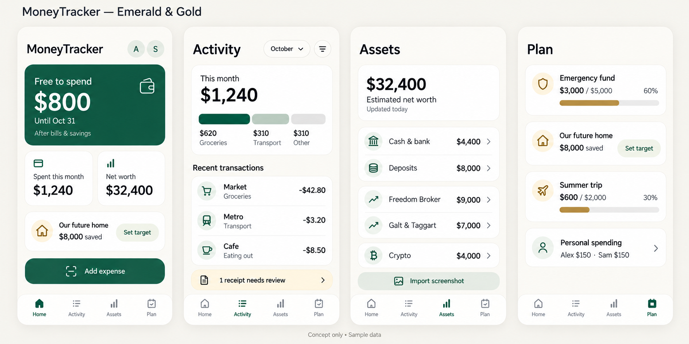

# MoneyTracker — Emerald & Gold

## Design links / Ссылки на дизайн

- [Full-size concept image / Картинка в полном размере](emerald-gold-v1.png)
- [Russian requirements / ТЗ на русском](../SPEC.ru.md)
- [English requirements / ТЗ на английском](../SPEC.en.md)

**Penpot file: pending upload after sign-in. No external design file has been created yet.**

**Файл Penpot: ожидает входа и загрузки. Внешний файл дизайна пока не создан.**

## Status / Статус

Preliminary raster concept, generated with the built-in image generator and selected for further refinement. Four screens: Home, Activity, Assets, Plan. All figures and names are sample data. The image is not a working application or an editable component library. Importing the PNG into Penpot preserves an image; it does not automatically produce editable text, cards or components.

Предварительный растровый концепт для дальнейшей проработки. Четыре экрана: главная, операции, активы, план. Все суммы и имена демонстрационные. Изображение не является приложением или библиотекой компонентов. Загрузка PNG в Penpot переносит картинку; редактируемые тексты, карточки и компоненты требуют отдельного построения.

## Palette / Палитра

| Role / Назначение | Target color / Целевой цвет |
|---|---|
| Primary actions, available funds / Основные действия и свободные деньги | Emerald `#185C45` |
| Background / Фон | Milk `#F7F5EF` |
| Goal icons and progress / Значки и прогресс целей | Muted gold `#B89045` |
| Text / Текст | Graphite `#202823` |

These are proposed implementation tokens; pixels in the generated image may vary. Small text should retain sufficient contrast rather than use gold on cream. Color associations are a visual preference, not a claim of financial benefit.

Это целевые токены для реализации: оттенки пикселей сгенерированной картинки могут отличаться. Мелкий текст должен быть контрастным; золотой на молочном не использовать как основной текст. Символика цвета — визуальное предпочтение, не обещание финансового результата.

## Next design work / Следующие задачи дизайна

- Receipt capture, review, duplicate detection and undo / Ввод чека, проверка, дубли и отмена.
- Empty, loading, offline and conflict states / Пустые состояния, загрузка, офлайн и конфликты.
- Household allocations and goal details / Распределение семейного бюджета и детали целей.
- Dark theme and small-screen accessibility / Тёмная тема и доступность на небольших экранах.
- Future educational mini-messages / Будущие образовательные мини-подсказки: contextual, dismissible, optional notifications; an editorial library without mandatory paid AI. This is a future design proposal, not an implemented feature / Контекстные подсказки с возможностью скрытия, уведомления по желанию; подготовленная библиотека без обязательного платного ИИ. Это предложение будущего дизайна, не реализованная функция.

## Generation brief / Задание генератору

Built-in image generation edited the original light concept: preserve all four screens, English labels, sample values and navigation; use emerald primary surfaces, milk backgrounds, graphite text, restrained matte gold for goal icons/progress; replace photo avatars with A/S initials. Keep the home target unspecified, preserve 60% emergency and 30% holiday progress, avoid decorative wealth symbols, and retain the sample-data footer. No Figma or Penpot file was generated by that operation.

Встроенный генератор изменил исходный светлый концепт: сохранить четыре экрана, английские надписи, демонстрационные суммы и навигацию; применить изумрудные акценты, молочный фон, графитовый текст и умеренное золото для целей; заменить фото аватаров инициалами A/S. Не придумывать стоимость квартиры; сохранить 60% и 30% прогресса, исключить декоративные символы богатства и оставить подпись о демонстрационных данных. Эта операция не создавала файл Figma или Penpot.
